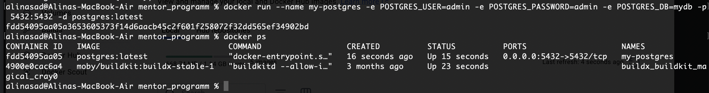
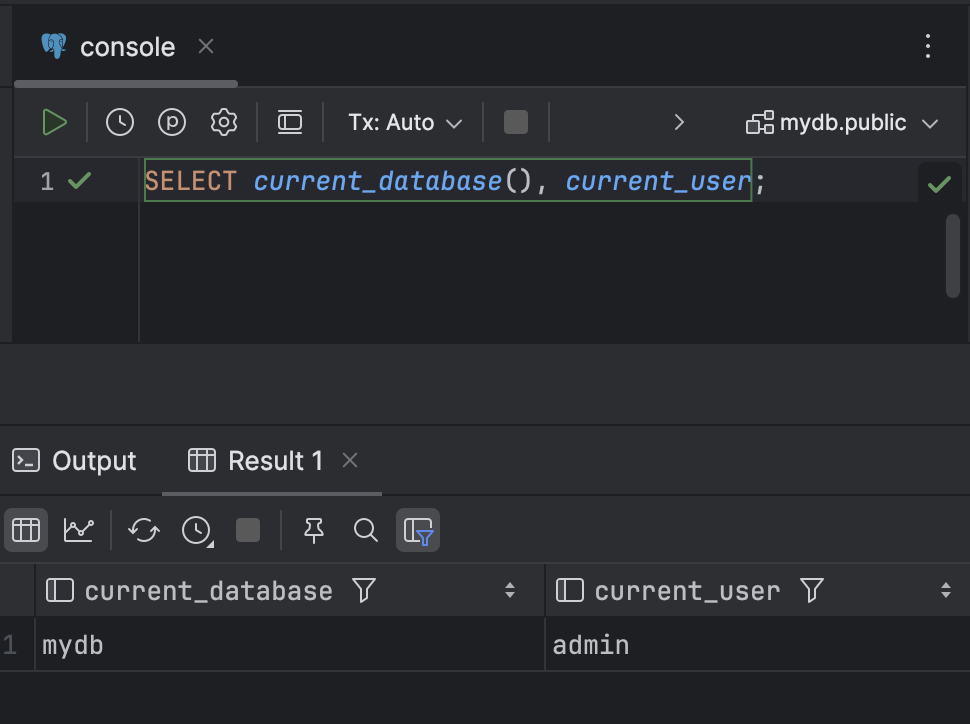
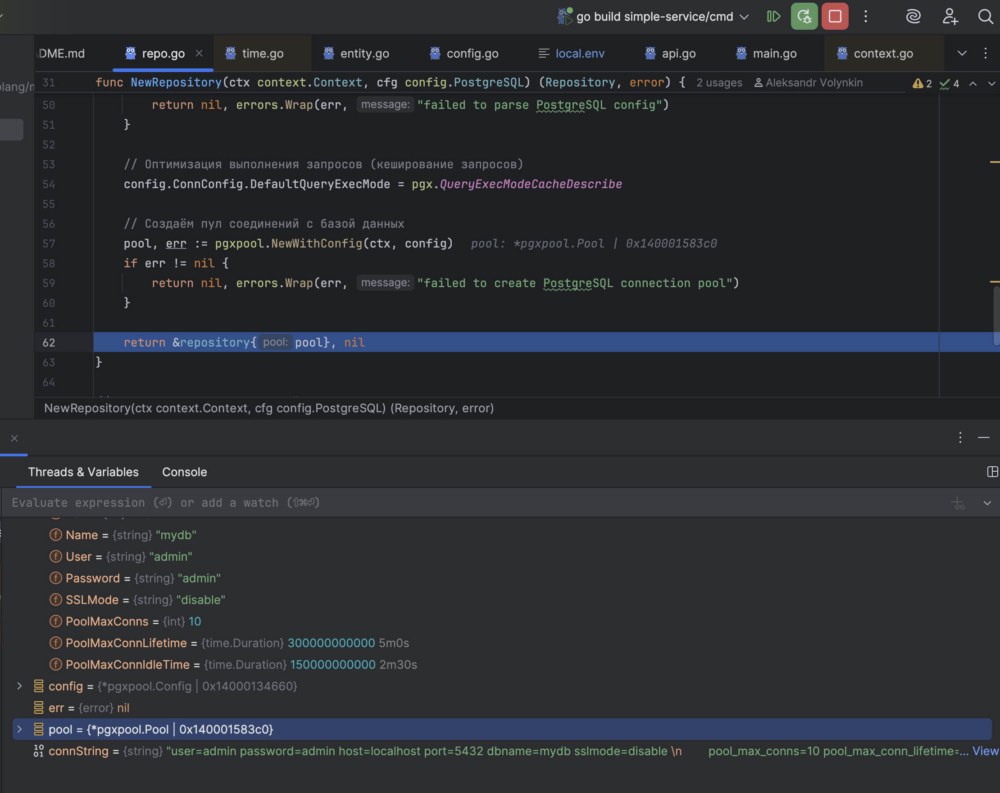
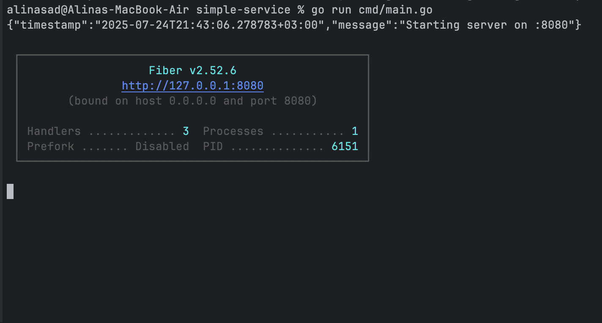
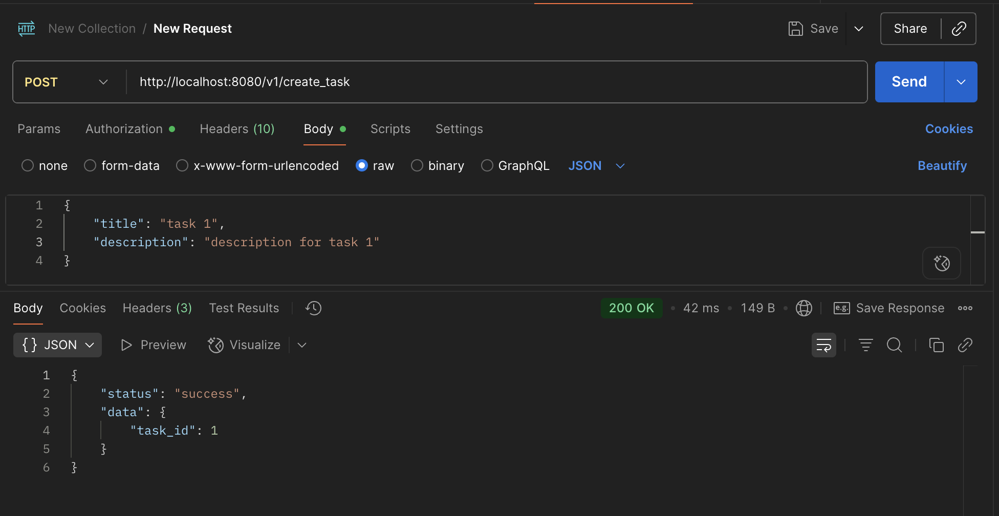
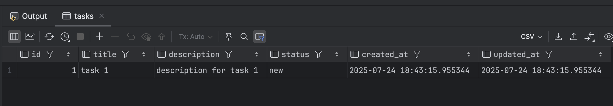

## Описание взаимодействия слоев:

### Handler (контроллер):
- получает http запросы (Post /v1/create_task)
- оборачивает все запросы с префиксом /v1 в middleware авторизации
- делегирует обработку запроса в сервисный слой (`r.Service.CreateTask`)

### Service (бизнес-логика):
- реализует функцию CreateTask для обработки запроса
- парсит тело запроса и валидирует данные
- создает сущность `repo.Task` и вызывает метод репозитория (`s.repo.CreateTask()`)

### Repository (работа с БД)
- выполняет sql запросы в БД (`INSERT INTO tasks ...`)
- возвращает id задачи (`... RETURNING id;`)

---
Слои взаимодействуют между собой главным образом через интерфейсы. Например:
- в `api.go` структура `Routes` содержит интерфейс `Service`, который описан в сервисном слое:
```go
type Routers struct {
    Service service.Service
}
```
- в `service.go` этот интерфейс описывается и реализуется структурой `service`, он состоит из интерфейса `Repository` и логгера:
```go
type service struct {
	repo repo.Repository
	log  *zap.SugaredLogger
}
```
- в `repo.go` описывается и реализуется этот интерфейс. Его реализует структура `repository`, которая может обращаться к БД через пул соединений:
```go
type repository struct {
	pool *pgxpool.Pool
}
```

## Скриншоты

**Запуск my-postgres**



**Проверка, что база работает:**



**Работа в debug-режиме:**



**Запущенный сервис:**



**Post запрос в Postman:**



**Get запрос в Postman:**


**Наличие данных в таблице**

